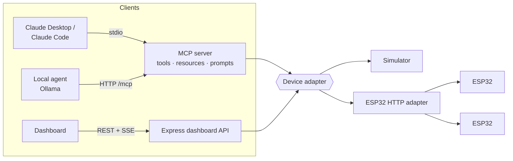

# 🛰️ IoT MCP Server

An [MCP](https://modelcontextprotocol.io) server that lets AI assistants **monitor and control ESP32 building devices** — air-quality monitors, a ventilation fan, an air purifier and an exhaust relay. Comes with a live dashboard, a built-in agent that runs on a **local model**, a realistic device simulator, and ESP32 firmware for real hardware.


> Ask *"The conference room feels stuffy"* → the agent checks alerts, sees CO₂ at 1,500 ppm, reads the trend, turns the ventilation fan up, and you watch CO₂ fall on the dashboard.

## What's inside

| | |
|---|---|
| **9 MCP tools** | `list_devices`, `get_device_status`, `get_room_summary`, `get_sensor_history`, `get_alerts`, `set_fan_speed`, `set_purifier_mode`, `set_relay`, `identify_device` |
| **Resources** | `iot://devices` and `iot://devices/{id}` |
| **Prompt** | `building_health_check` — investigate, fix, report |
| **Transports** | stdio (Claude Desktop, Claude Code, Cursor…) and Streamable HTTP at `/mcp` |
| **Dashboard** | Live device cards (SSE), manual controls, alerts, an activity log of every AI and human action, and an agent chat |
| **Local agent** | Tool-calling loop on Ollama (or any OpenAI-compatible API) that talks to the server over MCP — CLI and web |
| **Simulator** | Rooms with occupancy-driven CO₂, outdoor PM, solvent TVOC events; actuators actually change the air |
| **Real hardware** | `DEVICE_ADAPTER=http` + the Arduino sketch in `firmware/` |

## Architecture



One process serves MCP over stdio **and** the dashboard, sharing the same device state — so when Claude Desktop changes a fan, you see it live in the browser.

## Quick start

**Requirements:** Node.js 20+. [Ollama](https://ollama.com) only if you want the built-in agent.

```bash
npm run setup
npm run dev            # dashboard on http://localhost:5173, API + HTTP MCP on :3003
```

The simulator starts with real problems to solve: a stuffy meeting room (fan at 20%), a hazy open office (purifier off), a solvent spill in the lab, a low battery and an offline sensor.

### No-AI smoke test

```bash
npm --prefix server run demo
```

Launches the server over stdio, lists tools/resources/prompts, reads alerts, turns the fan to 90% and prints CO₂ dropping.

### Talk to it with a local model

```bash
ollama pull qwen2.5:7b
npm --prefix server run agent -- "Run a health check and fix what you can"
npm --prefix server run agent      # interactive
```

If `npm run dev` is running, the agent connects to `http://localhost:3003/mcp` and you can watch it work in the dashboard. Or use the **Ask the agent** panel in the dashboard itself.

### Use it from Claude Desktop

```bash
npm run build
```

Add to `claude_desktop_config.json` (Settings → Developer → Edit Config):

```json
{
  "mcpServers": {
    "iot-devices": {
      "command": "node",
      "args": ["/absolute/path/to/iot-mcp-server/server/dist/index.js"]
    }
  }
}
```

Restart Claude Desktop, then open http://localhost:3003 to watch what Claude does. For Claude Code: `claude mcp add iot-devices -- node /absolute/path/to/server/dist/index.js`.

### MCP Inspector

```bash
npm run build && npm --prefix server run inspect
```

## Real ESP32 devices

1. Flash `firmware/esp32_device/esp32_device.ino` (ArduinoJson v7). Set Wi-Fi, `DEVICE_KIND` and `DEVICE_ROOM`, and swap the sensor stubs for your SCD40 / PMS5003 / SGP40 / SHT4x drivers.
2. Copy `server/devices.example.json` to `server/devices.json` with your device IPs.
3. Set `DEVICE_ADAPTER=http` in `server/.env`.

Device contract: `GET /status` returns readings/actuators as JSON, `POST /command` accepts `{ "type": "set_fan_speed", "speed": 60 }` and friends. Devices that miss 3 polls are marked offline, and commands to them are refused.

## Safety

- Every command is validated against the device type and online state; wrong-type or offline commands return MCP errors the model can read and recover from.
- Read tools are annotated `readOnlyHint`; control tools are idempotent and non-destructive.
- Every action is recorded in the activity log with its source (MCP client, agent, dashboard) and the model's stated reason.
- In stdio mode all logs go to stderr so they never corrupt the protocol stream.

## Configuration (`server/.env`)

| Variable | Default | |
|---|---|---|
| `DEVICE_ADAPTER` | `sim` | `sim` or `http` |
| `SIM_SPEED` | `5` | Simulation speed-up so effects show within ~30s |
| `PORT` | `3003` | Dashboard + HTTP MCP |
| `LLM_PROVIDER` / `LLM_MODEL` | `ollama` / `qwen2.5:7b` | For the built-in agent (`ollama` or `openai`) |

## Scripts

`npm run dev` · `npm run build` · `npm test` · `npm --prefix server run demo | agent | inspect`

## License

MIT © Faisal
