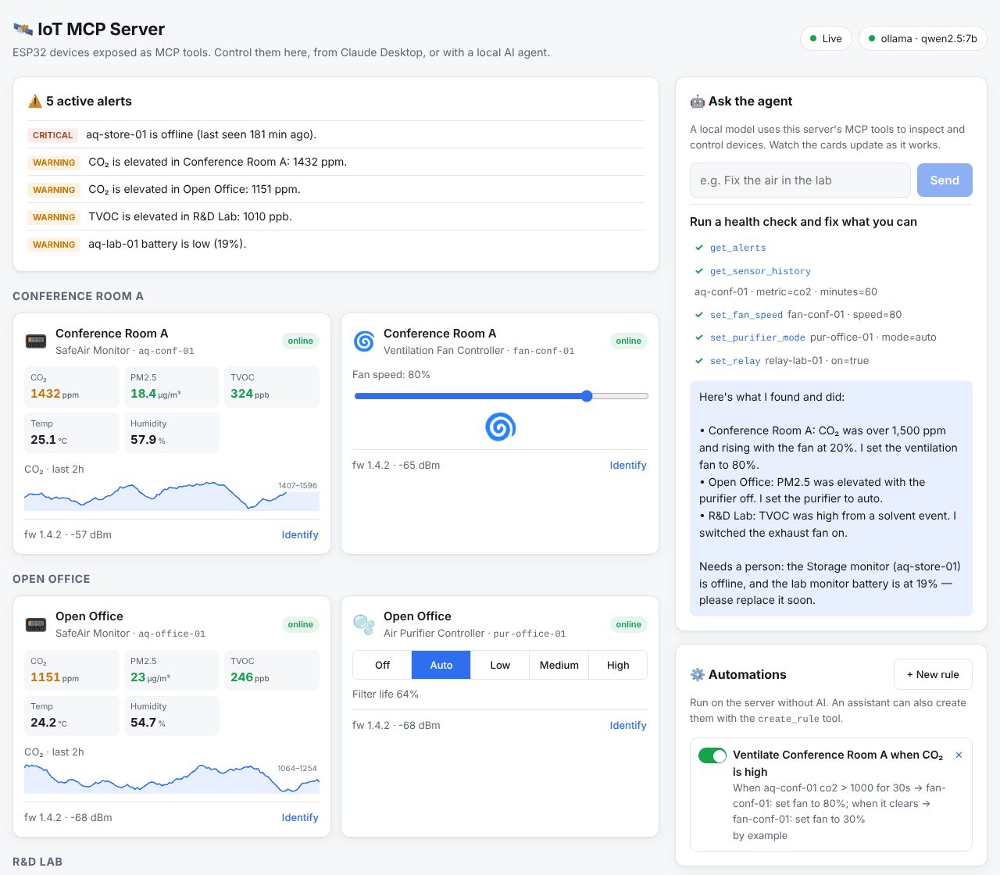
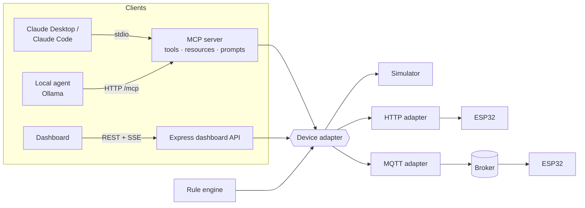

# 🛰️ IoT MCP Server

An [MCP](https://modelcontextprotocol.io) server that lets AI assistants **monitor and control ESP32 building devices** — air-quality monitors, a ventilation fan, an air purifier and an exhaust relay. Comes with a live dashboard, a built-in agent that runs on a **local model**, a realistic device simulator, and ESP32 firmware for real hardware.




<sub>Screenshot: simulated devices after the agent's health check, with the example automation enabled.</sub>

> Ask _"The conference room feels stuffy"_ → the agent checks alerts, sees CO₂ at 1,500 ppm, reads the trend, turns the ventilation fan up, and you watch CO₂ fall on the dashboard.

## What's inside

|                   |                                                                                                                                                                                                                                   |
| ----------------- | --------------------------------------------------------------------------------------------------------------------------------------------------------------------------------------------------------------------------------- |
| **13 MCP tools**  | `list_devices`, `get_device_status`, `get_room_summary`, `get_sensor_history`, `get_alerts`, `set_fan_speed`, `set_purifier_mode`, `set_relay`, `identify_device`, `list_rules`, `create_rule`, `set_rule_enabled`, `delete_rule` |
| **Automations**   | Rules that keep running without AI: "when CO₂ > 1000 for 30s, fan to 80%; when it clears, back to 30%"                                                                                                                            |
| **Resources**     | `iot://devices` and `iot://devices/{id}`                                                                                                                                                                                          |
| **Prompt**        | `building_health_check` — investigate, fix, report                                                                                                                                                                                |
| **Transports**    | stdio (Claude Desktop, Claude Code, Cursor…) and Streamable HTTP at `/mcp`                                                                                                                                                        |
| **Dashboard**     | Live device cards (SSE), manual controls, alerts, an activity log of every AI and human action, and an agent chat                                                                                                                 |
| **Local agent**   | Tool-calling loop on Ollama (or any OpenAI-compatible API) that talks to the server over MCP — CLI and web                                                                                                                        |
| **Simulator**     | Rooms with occupancy-driven CO₂, outdoor PM, solvent TVOC events; actuators actually change the air                                                                                                                               |
| **Real hardware** | ESP32 over **HTTP** or **MQTT** (`DEVICE_ADAPTER=http` / `mqtt`), Arduino sketches for both in `firmware/`, and an optional built-in MQTT broker                                                                                  |

## Architecture



One process serves MCP over stdio **and** the dashboard, sharing the same device state — so when Claude Desktop changes a fan, you see it live in the browser.

## Quick start

**Requirements:** Node.js 20+. [Ollama](https://ollama.com) only if you want the built-in agent.

```bash
npm run setup
npm run dev            # dashboard on http://localhost:5173, API + HTTP MCP on :3003
```

The simulator starts with real problems to solve: a stuffy meeting room (fan at 20%), a hazy open office (purifier off), a solvent spill in the lab, a low battery and an offline sensor.

### No-AI smoke test

```bash
npm --prefix server run demo
```

Launches the server over stdio, lists tools/resources/prompts, reads alerts, turns the fan to 90% and prints CO₂ dropping.

### Talk to it with a local model

```bash
ollama pull qwen2.5:7b
npm --prefix server run agent -- "Run a health check and fix what you can"
npm --prefix server run agent      # interactive
```

If `npm run dev` is running, the agent connects to `http://localhost:3003/mcp` and you can watch it work in the dashboard. Or use the **Ask the agent** panel in the dashboard itself.

### Use it from Claude Desktop

```bash
npm run build
```

Add to `claude_desktop_config.json` (Settings → Developer → Edit Config):

```json
{
  "mcpServers": {
    "iot-devices": {
      "command": "node",
      "args": ["/absolute/path/to/iot-mcp-server/server/dist/index.js"]
    }
  }
}
```

Restart Claude Desktop, then open http://localhost:3003 to watch what Claude does. For Claude Code: `claude mcp add iot-devices -- node /absolute/path/to/server/dist/index.js`.

### MCP Inspector

```bash
npm run build && npm --prefix server run inspect
```

## Automations

Rules watch one sensor metric and command one device — no AI in the loop, so they keep working when the model is off.

- Fire once when the condition has held for `forSeconds`, then re-arm only after it clears (no re-commanding every tick).
- Optional **when it clears** action, e.g. return the fan to 30%.
- Validated against real devices: a rule can't send a fan command to a purifier.
- Created from the dashboard's **Automations** panel or by an assistant: _"Keep the conference room CO₂ under 1000"_ → `create_rule`.
- Saved to `server/data/rules.json`; every firing is in the activity log with the reading that triggered it.

An example rule ships disabled — switch it on in the dashboard to watch it work.

## Real ESP32 devices

### Over MQTT (recommended)

1. Flash `firmware/esp32_mqtt/esp32_mqtt.ino` (PubSubClient + ArduinoJson v7). Set Wi-Fi, `MQTT_HOST`, `DEVICE_ID`, `DEVICE_KIND` and `DEVICE_ROOM`, and swap the sensor stubs for your SCD40 / PMS5003 / SGP40 / SHT4x drivers.
2. In `server/.env`: `DEVICE_ADAPTER=mqtt`, and either point `MQTT_URL` at your broker (Mosquitto, EMQX, HiveMQ…) or set `MQTT_EMBEDDED_BROKER=true` to run one inside this server on port 1883.

Topics (prefix `iot`): devices publish `iot/<id>/status` (JSON, retained) and `iot/<id>/online` (Last Will `false`); the server publishes commands to `iot/<id>/command` with a `requestId` and waits for `iot/<id>/ack`. Devices silent for 60s are shown offline.

No hardware yet? Run the simulated building as MQTT devices:

```bash
# terminal 1: server with its own broker
DEVICE_ADAPTER=mqtt MQTT_EMBEDDED_BROKER=true npm run dev
# terminal 2: seven simulated ESP32s
npm --prefix server run sim:mqtt
```

### Over HTTP

1. Flash `firmware/esp32_http/esp32_http.ino`. Each device serves `GET /status` and `POST /command`.
2. Copy `server/devices.example.json` to `server/devices.json` with your device IPs, and set `DEVICE_ADAPTER=http`.

Devices that miss 3 polls are marked offline, and commands to them are refused.

## Safety

- **Local by default:** the dashboard and HTTP MCP endpoint listen on `127.0.0.1` only. To reach them from other machines set `HOST=0.0.0.0` **and** `AUTH_TOKEN=<long random string>`.
- **Token auth:** with `AUTH_TOKEN` set, `/api/*` and `/mcp` require `Authorization: Bearer <token>` (the dashboard asks for it once, or open `/?token=…`). `/api/health` stays public. Compared in constant time.
- **MQTT credentials:** the built-in broker listens on your network so devices can reach it; set `MQTT_USERNAME` and `MQTT_PASSWORD` and every client (devices, simulator and this server) must log in.

- Every command is validated against the device type and online state; wrong-type or offline commands return MCP errors the model can read and recover from.
- Read tools are annotated `readOnlyHint`; control tools are idempotent and non-destructive.
- Every action is recorded in the activity log with its source (MCP client, agent, dashboard) and the model's stated reason.
- In stdio mode all logs go to stderr so they never corrupt the protocol stream.

## Configuration (`server/.env`)

| Variable                            | Default                           |                                                 |
| ----------------------------------- | --------------------------------- | ----------------------------------------------- |
| `DEVICE_ADAPTER`                    | `sim`                             | `sim`, `http` or `mqtt`                         |
| `MQTT_URL` / `MQTT_EMBEDDED_BROKER` | `mqtt://localhost:1883` / `false` | MQTT broker, or run one built in                |
| `SIM_SPEED`                         | `5`                               | Simulation speed-up so effects show within ~30s |
| `PORT`                              | `3003`                            | Dashboard + HTTP MCP                            |
| `LLM_PROVIDER` / `LLM_MODEL`        | `ollama` / `qwen2.5:7b`           | For the built-in agent (`ollama` or `openai`)   |

## Scripts

`npm run dev` · `npm run build` · `npm test` · `npm --prefix server run demo | agent | inspect | sim:mqtt`

[](https://m8ven.ai/mcp/sfs1109756/iot-mcp-server?s=readme)

## License

MIT © Faisal
